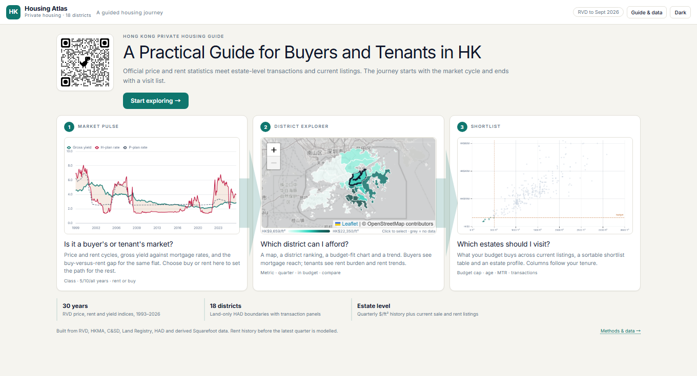
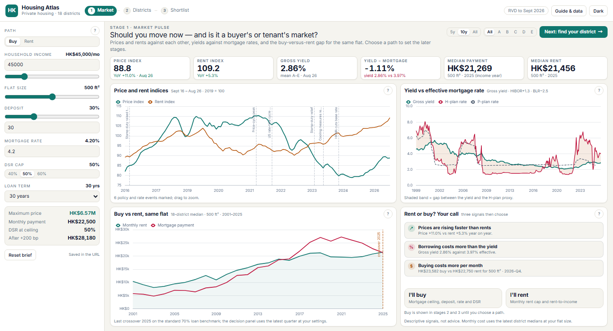
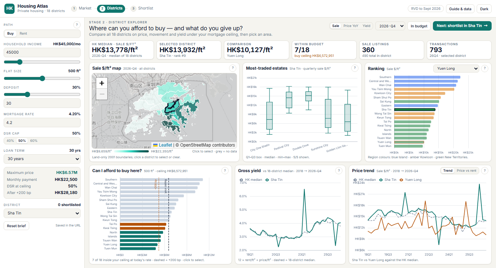
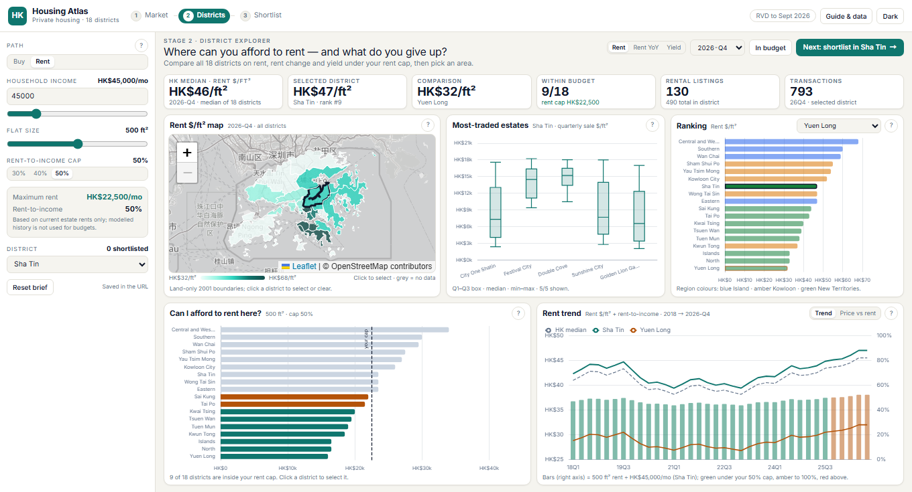
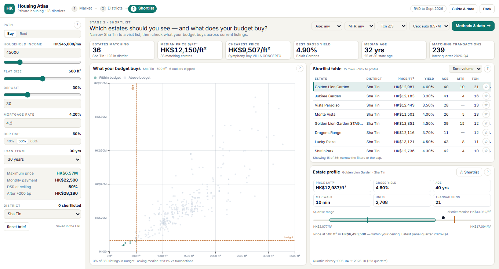
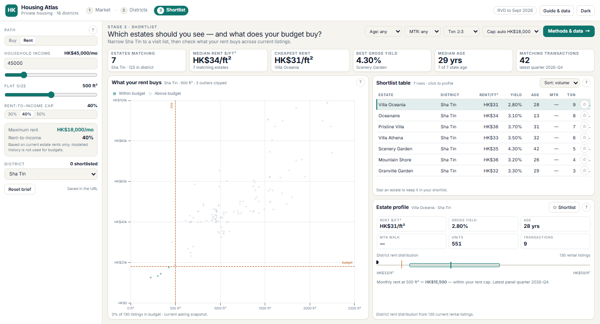
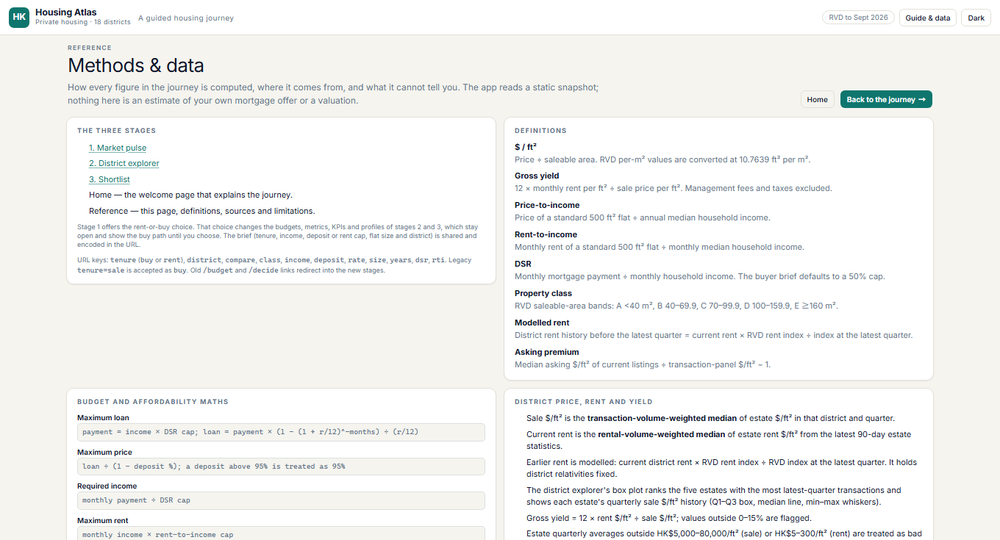

# HK Housing Atlas

An interactive guide to Hong Kong's private housing market built as a **three-stage decision journey** for buyers and tenants. It combines three decades of official statistics with estate-level transaction history and current listings.

The app opens on a welcome page that explains the journey. Stage 1 analyses the market and offers the **rent or buy** choice; stages 2 and 3 stay open and show the buy variant until a path is chosen, then adapt their budgets, metrics, filters and charts to that path.

| Route | Page | Question it answers |
|---|---|---|
| `/` | **Welcome** | What is this journey, and how does it work? |
| `/market` | **Stage 1 · Market pulse** | Is it a buyer's or tenant's market — and should I rent or buy? |
| `/explore` | **Stage 2 · District explorer** | Which district can I afford, and what do I give up? |
| `/shortlist` | **Stage 3 · Shortlist** | Which estates should I see, and what does my budget buy? |
| `/methods` | **Reference** | Definitions, sources and limitations |



## The rent/buy choice and the tenure variants

- Stage 1 ends with the choice **I'll buy** or **I'll rent**; the rail's **Buy / Rent** control is available from the first load and sets the same path. Stages 2 and 3 are always open: until a path is chosen they render the buy variant and the rail shows Buy selected.
- Choosing does not auto-navigate; the market charts respond first. The “Next: find your district” CTA is always available. The path stays editable in the rail.
- **Buyers** get a mortgage ceiling from income, deposit, rate, term and DSR cap; the district explorer ranks required income and transaction prices, and the shortlist profiles use sale quartile history.
- **Tenants** get a monthly rent cap from income and rent-to-income; the district explorer ranks rent burden and rent movement, and the shortlist profiles show the district rent distribution instead of sale history.
- Switching path later re-renders stages 2 and 3 and keeps the selected district and shortlist.



## Status

The three-stage revision is complete as of **2026-11-13**. It replaces the earlier five-stage layout; `/budget` and `/decide` no longer exist and redirect to `/explore` and `/shortlist`. Nothing in `pipeline/` or `data/` changed, and no JSON schema changed.

| Phase | Scope | Status |
|---|---|---|
| 0 | Delete stale UI, docs and assets | complete |
| 1 | Shell, 3-step nav, rent/buy choice, URL state, UI primitives | complete |
| 2 | Welcome page | complete |
| 3 | Stage 1 — Market pulse + rent/buy choice | complete |
| 4 | Stage 2 — District explorer (buy/rent variants) | complete |
| 5 | Stage 3 — Shortlist + what your budget buys | complete |
| 6 | Data notes, Methods, Guide, dark mode, docs, captures | complete |

The full design and verification record is in [docs/JOURNEY_REBUILD_PLAN.md](docs/JOURNEY_REBUILD_PLAN.md).

## Quick start (Windows)

```powershell
cd visualProject

# 1. Install Python and Node dependencies
powershell -ExecutionPolicy Bypass -File scripts\setup.ps1

# 2. Build official data + analytics + frontend JSON
powershell -File scripts\build-data.ps1

# 3. Optional: refresh the Squarefoot sample (respects robots.txt; ~20 min)
powershell -File scripts\build-data.ps1 -Crawl

# 3b. Optional: full residential crawl (~26,000 pages; about 7-10 hours)
powershell -File scripts\crawl-full.ps1

# 4. Run the app
powershell -File scripts\dev.ps1
# open http://127.0.0.1:5173
```

Production build and preview:

```powershell
npm --prefix app run build
npm --prefix app run preview
```

## How the journey works

### The brief

A persistent rail on stages 1–3 holds the shared state:

- **Path** — Buy or Rent, selectable in the rail from the first load. Buy is shown until a choice is made.
- **Household income** — slider and exact input.
- **Flat size** — 200–800 ft², used for every per-district price and rent.
- **Buyers** — deposit, mortgage rate, loan term and a 40/50/60% DSR cap; the rail shows the maximum price, monthly payment, DSR and the +200 bp stressed payment.
- **Tenants** — a 30/40/50% rent-to-income cap; the rail shows the maximum rent.
- **District** — set by the rail, a map click or a ranking/budget click; the shortlist count is shown here.
- **Reset** — clears the brief, returns to the welcome page and leaves stages 2 and 3 open on the buy variant.

While no path is chosen, the rail shows the buy inputs and ceiling, because stages 2 and 3 default to buy. Choosing Rent switches the rail to the rent cap.

### URL state

The brief is mirrored into the query string with stable, validated keys:

```
/market?tenure=buy&income=60000&deposit=30&size=650
/explore?tenure=rent&district=M&income=45000
```

`tenure` is `buy` or `rent`; the internal `sale` value and the legacy URL `tenure=sale` are accepted as buy. `income`, `deposit`, `rate`, `size`, `years`, `dsr` and `rti` are written only when they differ from defaults; malformed values are ignored and out-of-range numbers are clamped. The shortlist is session-only and is not serialised.

### One-screen guarantee

On desktop (≥1200 px wide) the shell is a fixed-height grid: 48 px top bar, 232 px rail, then a 40 px stage header, a 52 px KPI strip and a two-row bento grid that consumes the remaining height. Charts fill their cells and ECharts' `ResizeObserver` keeps them in sync. At **1360 × 735** every stage measures `scrollHeight = 735`; at 1440 × 900 the stage-2 chart cells grow from about 222 px to 299 px. The welcome page and Methods use the full width without a rail; below 700 px viewport height pages scroll, and below 1200 px the rail becomes a filter bar and panels stack.

## Stage by stage

### Welcome (`/`)

A hero (“A Practical Guide for Buyers and Tenants in HK”) with a scannable QR code, three journey cards each with a dashboard chart screenshot, its question, description and filter meta, joined by translucent accent arrows, a short facts strip and the data note. The primary CTA starts `/market`. The cards are previews; navigation is through the CTA and the stage stepper.

### Stage 1 — Market pulse (`/market`)

RVD price and rent indices rebased to 2019 = 100 (class and 5/10/all-year filters, nine event markers); gross yield against the HIBOR+1.3 and BLR−2.5 mortgage proxies with the spread shaded; the 18-district median monthly rent and mortgage payment for 500 ft² since 2001 with the last crossover; and a **“Rent or buy? Your call”** panel with three signals — price vs rent momentum, yield vs mortgage, and the monthly buy-vs-rent cost for the user's flat size — followed by the choice that sets the later stages.

KPIs: price index + YoY, rent index + YoY, gross yield, yield − mortgage, median payment, median rent.



### Stage 2 — District explorer (`/explore`)

A land-only choropleth of the chosen metric and quarter (quantile breaks for levels, diverging for price/rent YoY), a **box plot of the five most-traded estates** in the selected district (their quarterly sale $/ft² history), a region-coloured district ranking, a **budget-fit chart** of the monthly price or rent for the user's flat size against the ceiling (plus the +200 bp stressed ceiling for buyers), a **gross-yield** panel for buyers comparing the selected district with the 18-district median, and a trend panel with a **Price vs rent** toggle. In rent mode the trend panel is dual-axis: rent $/ft² on the left and the **rent-to-income** ratio of the brief's flat size and income on the right, drawn as bars coloured green below your cap, amber from the cap to 100% of income, and red above (0–100% axis while the ratio stays below 1, otherwise scaled to the peak). The **In budget** toggle greys districts outside the budget across the map and ranking. Buyers see sale $/ft², price YoY and yield; tenants see rent $/ft², rent YoY and yield. Clicking the map, a ranking bar or a budget bar selects the district; ranking clicks set the comparison.

KPIs: HK median of the metric, selected value + rank, comparison, districts within budget, sale/rental listings in the district, transactions.



### Stage 3 — Shortlist (`/shortlist`)

The **what your budget buys** scatter occupies the left column (area vs total asking price for buyers, area vs monthly rent for tenants, with budget and size lines and the reachable share); the right column holds a sortable 15-row shortlist table with stars and click-to-profile above the estate profile. Buyers see the full-history sale quartile range plus the district median; tenants see the district's current rent distribution with the estate and rent-cap markers. Filters: district, budget cap, age, MTR walk, minimum transactions and sort.

KPIs: estates matching, median matching $/ft², cheapest, best yield, median age, matching transactions.




### Data notes, guide and theme

Every chart has a **?** button that opens a data note: what it is, its sources and how it is processed. The **Guide & data** button explains the three stages and the rent/buy choice, defines key terms, repeats the limitations, shows the QR code and links to `/methods`. Charts are palette-driven and re-render on the light/dark toggle; the choice is stored in `localStorage` and applied before first paint.



## Repository state

```
visualProject/
  app/                      React app (welcome, three stages, Methods)
  pipeline/                 Python data pipeline (unchanged)
  data/                     raw + processed snapshots (unchanged)
  scripts/                  setup, data build, dev, test, crawl
  docs/                     METHODOLOGY, SOURCES, DATA_DICTIONARY, JOURNEY_REBUILD_PLAN
  proposal.docx
```

The deletions from the earlier interface remain in place; the new routes and components replaced them. Nothing in `pipeline/` or `data/` changed.

## Data

| Source | Role | Access |
|---|---|---|
| Rating and Valuation Department (RVD) | Price/rental indices 1993–, yields 1999–, sales 2002–, completions 1985– | [RVD statistics](https://www.rvd.gov.hk/en/publications/property_market_statistics.html) |
| Hong Kong Monetary Authority (HKMA) | Mortgage survey, HIBOR, best lending rate | [HKMA API](https://apidocs.hkma.gov.hk/), bulletin workbooks |
| Census and Statistics Department (C&SD) | Median household income and household size by district, 2001–2025 | [Table 130-06806](https://www.censtatd.gov.hk/en/web_table.html?id=130-06806) |
| Land Registry | Monthly ASP counts and consideration, 2021–2026 | [data.gov.hk](https://data.gov.hk/en-data/dataset/hk-lr-data4-landreg) |
| Home Affairs Department | 18 District Council boundaries, clipped to land-only shapes for the map | [data.gov.hk](https://data.gov.hk/en-data/dataset/hk-had-json1-hong-kong-administrative-boundaries); land clip from [geohk](https://github.com/hupili/geohk) |
| Squarefoot (28Hse group) | Current listings and estate-level quarterly price series | Polite crawl; derived statistics only |

The current snapshot is the completed full residential crawl: **13,962 listing records**, **12,013 estate pages**, **4,887 estates with quarterly charts**, **4,709 estates with an assigned district** and **13,431 listings** in the listing-level sample used for “what your budget buys”. The latest panel quarter contains **1,337 estates** and **7,442 transactions**. One estate URL in the sitemap returns 404 and is logged. Office, shop, carpark and news pages are excluded.

The district polygons are intersected with the **land-only census2001 district geometry** from [geohk](https://github.com/hupili/geohk), so the choropleth excludes sea while keeping the statutory HAD district lines. The coastline vintage is 2001; recent reclamation is not represented.

Estate records carry no coordinates (`lat`/`lon` are null for all 1,337 latest-quarter estates), so the design compares estates with distributions and listings with scatter plots rather than a map.

### Data-quality guards in the app

- Estate averages outside **HK$5,000–80,000/ft² (sale)** or **HK$5–300/ft² (rent)** are treated as bad records and excluded from estate views.
- Estate gross yields outside 0–15% are flagged by the pipeline and excluded from the “best yield” KPI.
- The budget-buys scatter clips at the 99th percentile of area and total cost (the raw sample reaches 22,500 ft² and HK$964k/ft²) and states the number of clipped outliers.
- When no district is selected in stage 3, the buyer asking benchmark is the listing-mix-weighted district transaction median, not the equal-weight district median.
- Tenant rent distributions are not drawn with fewer than three listings.

### Crawl compliance

- Squarefoot's `robots.txt` allows path-based pages and disallows search-query submissions; the crawler only uses path pages and the sitemap.
- One request at a time, 1.0–1.4 s delay, gzip cache, retries with backoff, and a stop on 403/429.
- No login, agent-contact or photo pages. Only property attributes are stored; agent names, phone numbers, photos and descriptions are not.
- Raw HTML is cached under `data/raw/` (git-ignored) and is not redistributed. The app ships derived aggregates and anonymised listing attributes only.
- Confirm Squarefoot's terms for your own use before a large crawl.

## Pipeline

```powershell
.\.venv\Scripts\python -m pipeline.build --stage official    # RVD, HKMA, C&SD, Land Registry, HAD
.\.venv\Scripts\python -m pipeline.build --stage crawl       # Squarefoot listings + estates
.\.venv\Scripts\python -m pipeline.build --stage analytics   # district panel, affordability, listing sample
.\.venv\Scripts\python -m pipeline.build --stage build       # export JSON for the app
.\.venv\Scripts\python -m pipeline.build --stage all         # all of the above
```

Full residential crawl:

```powershell
.\.venv\Scripts\python -m pipeline.full_crawl --delay 1.0
```

It reads the sitemap, normalises every URL to the English locale, and resumes from `data/raw/squarefoot/listings.jsonl` and `estates.jsonl`. Progress is written to `full_crawl_progress.json`; failures go to `crawl_errors.jsonl`. At roughly one request per second the full run takes 7–10 hours. Afterwards, rebuild the derived data with the analytics and build stages.

Outputs:

```
data/processed/latest/
  market.json            RVD, HKMA, C&SD, Land Registry series + events
  districts.json         district panel, class medians, estate scatter, affordability
  districts.geojson      simplified 18-district boundaries
  pca.json               listing-level records (area, $/ft², district, tenure)
  estate-quartiles.json  per-estate sale $/ft² distributions (box-plot data)
  manifest.json          as-of dates, sources, counts
```

The same files are copied to `app/public/data/latest/` for the static app. The listing-level file is consumed as plain records; no dimension-reduction model is used in the interface.

## App structure

```
app/src/
  routes/              Home, Pulse (/market), Explore, Shortlist, Methods
  components/          AppShell, StageNav, BriefRail, StageHeader, Panel, Stat,
                       Segmented, DataNote, GuideDrawer, TenureChoice,
                       DistrictMap, Chart, EmptyState
  data/                typed JSON loaders, listing sample, cardInfo data notes
  state/               journey brief (Zustand) + theme store
  lib/                 format, stats, finance, journey budget maths,
                       listings, marketSeries, districtMetrics, chartOptions, filterUrl
```

- Charts are ECharts; the district map is Leaflet (no WebGL requirement).
- Routes are lazy-loaded. ECharts and Leaflet are not in the initial bundle.
- The brief is serialised to the URL; navigation between stages preserves it and copied links rehydrate.
- The welcome page and Methods hide the rail and stepper; Methods scrolls inside the main column.

## Key definitions

- **Sale $/ft²** = price ÷ saleable area. RVD per-m² values are converted at 10.7639 ft²/m².
- **Gross yield** = 12 × monthly rent/ft² ÷ sale price/ft². Management fees and taxes excluded.
- **Price-to-income** = price of a standard 500 ft² flat ÷ annual median household income.
- **Rent-to-income** = monthly rent of a standard 500 ft² flat ÷ monthly median household income.
- **DSR** = monthly mortgage payment ÷ monthly household income; the buyer default cap is 50%.
- **District sale price** = transaction-volume-weighted **median** of estate $/ft².
- **District rent** = rental-volume-weighted **median** of current estate rent $/ft², backcast with the RVD rental index.
- **Asking premium** = class median asking $/ft² ÷ district transaction $/ft² − 1.

More detail: [docs/METHODOLOGY.md](docs/METHODOLOGY.md), [docs/SOURCES.md](docs/SOURCES.md), [docs/DATA_DICTIONARY.md](docs/DATA_DICTIONARY.md).

## Tests and verification

```powershell
powershell -File scripts\test.ps1
```

- Python: 14 pipeline tests pass.
- Frontend: `tsc --noEmit`, the production build and **47 Vitest tests** pass (`stats`, `finance`, `format`, `colorScale`, `filterUrl`, `journey`, `marketSeries`, `listings`).
- Layout: a Puppeteer harness visits the welcome page, both tenure variants of each stage and Methods at 1360 × 735 and 1440 × 900, plus the welcome page at 390 × 844; it prints `scrollHeight`, `scrollWidth`, canvas counts and console errors.

Measured results:

| Check | Result |
|---|---|
| `/`, `/market`, `/explore` and `/shortlist` at 1360 × 735 | `scrollHeight = 735`, `scrollWidth = 1360`, 0 console errors |
| Buyer and tenant variants of stages 2 and 3 | fit; labels, metrics, KPIs and profiles differ |
| Buyer second row | budget fit · gross yield · price trend fit side by side at 1360 × 735 and 1440 × 900; the tenant row stays 50/50 |
| Stage 3 layout | what your budget buys spans the full left column; shortlist table and estate profile stack on the right at 1360 × 735 and 1440 × 900 |
| Stage 2 estate boxes | five most-traded estates drawn between the map and ranking; Sha Tin 5/5, Southern 4/5 with the count stated |
| Unchosen path on `/explore` or `/shortlist` | renders the buy variant with no lock card; the stepper links to all three stages |
| `/methods` at 1360 × 735 | document stays 735; the main column scrolls internally |
| 1440 × 900 | fit; stage-2 chart cells grow from about 222 px to 299 px |
| Welcome at 390 × 844 | stacks and scrolls; no horizontal overflow |
| Welcome arrows | 43.2 × 210 px at 20% opacity, centred on both card gaps; hidden below 900 px |
| Dark mode at 1360 × 735 | fits; palette and map chrome switch |
| Rent/buy choice | fresh `/market` shows both choices and an always-available next CTA; choosing adds `tenure=buy/rent` and switches both later stages |
| Redirects | `/budget → /explore`, `/affordability → /explore`, `/decide → /shortlist`, `/districts → /explore`, query preserved |
| Reset | returns to `/`, clears the path; stages remain open on the buy variant |

Captures for this revision are in [docs/screenshots-v3/](docs/screenshots-v3/).

## Limitations

- The crawl is a **current snapshot**; it cannot reconstruct ten years of listings. Long-run series come from RVD and estate quarterly history.
- Rent history before the latest 90-day estate statistics is **modelled** from the RVD rental index, holding district relativities fixed.
- Listing prices are asking prices; transactions are used for trend and yield calculations where available.
- Affordability uses household income, not buyer income, and excludes stamp duty, legal fees, management fees and vacancy costs.
- District price series are estate-based, not a random sample of the housing stock; coverage varies by district.
- Estate quarterly panels can be volatile when the estate mix changes between quarters; price and rent YoY inherit that volatility.
- The listing-level sample is a current asking snapshot, not a transaction record.
- Relationships shown are associations, not causal estimates. Nothing here is investment advice.
- Cells with fewer than three estates (or fewer than ten transactions) are provisional or suppressed.

## Documentation

- [docs/JOURNEY_REBUILD_PLAN.md](docs/JOURNEY_REBUILD_PLAN.md) — design, stage specifications and verification record.
- [docs/METHODOLOGY.md](docs/METHODOLOGY.md) — how each figure is computed.
- [docs/SOURCES.md](docs/SOURCES.md) — endpoints, coverage and licences.
- [docs/DATA_DICTIONARY.md](docs/DATA_DICTIONARY.md) — every output field.

## License / attribution

Code: MIT. Data remains subject to the terms of each provider. RVD, HKMA, C&SD, Land Registry and HAD data are used with attribution. Squarefoot-derived figures are aggregated and are not a substitute for the source listings.
