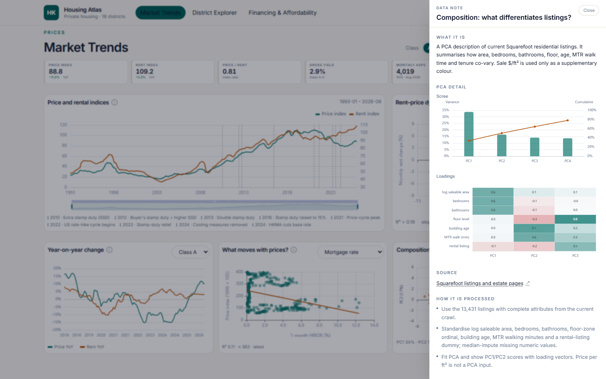
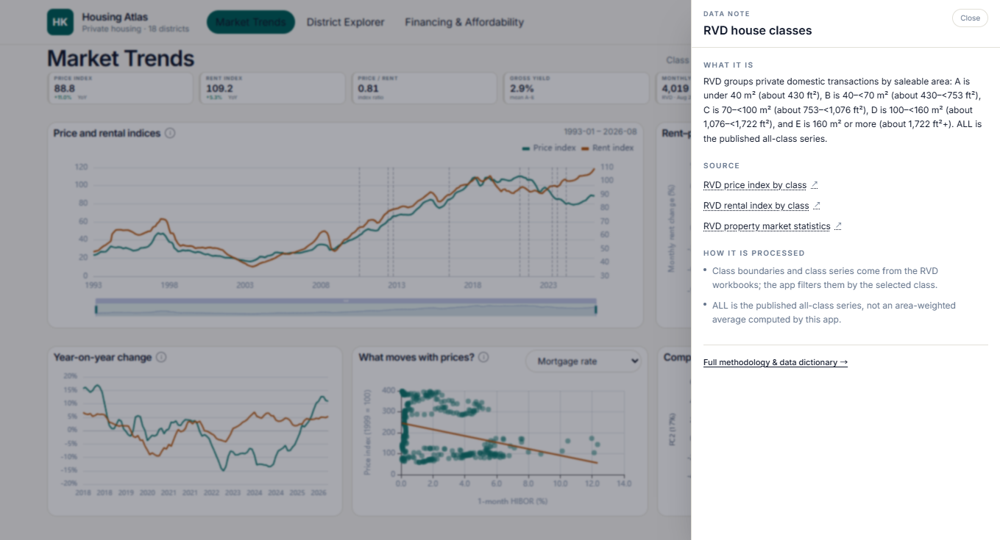
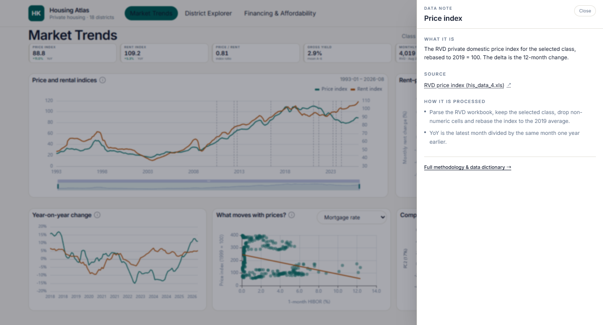
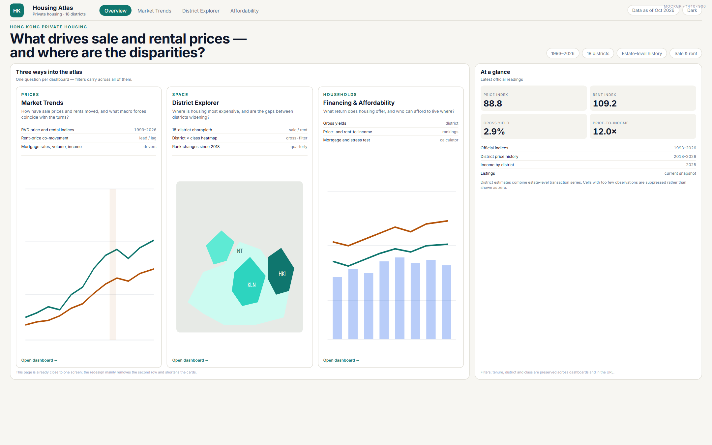
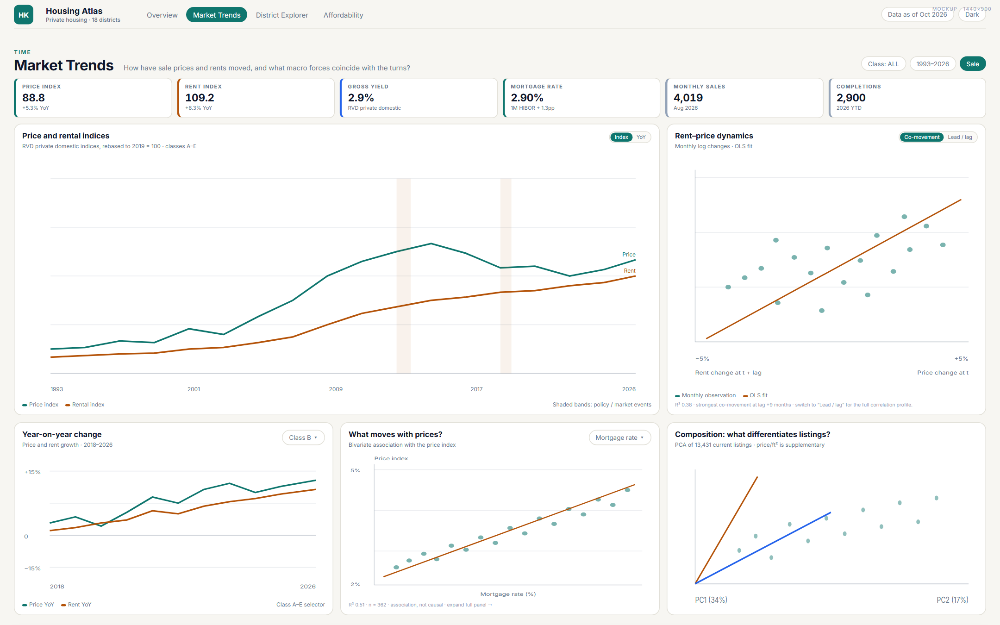
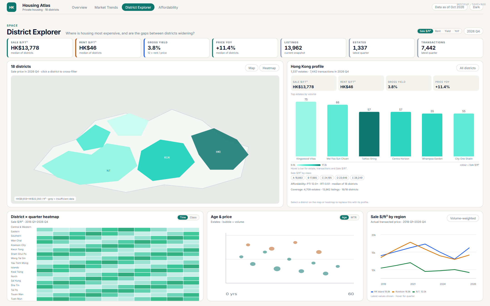
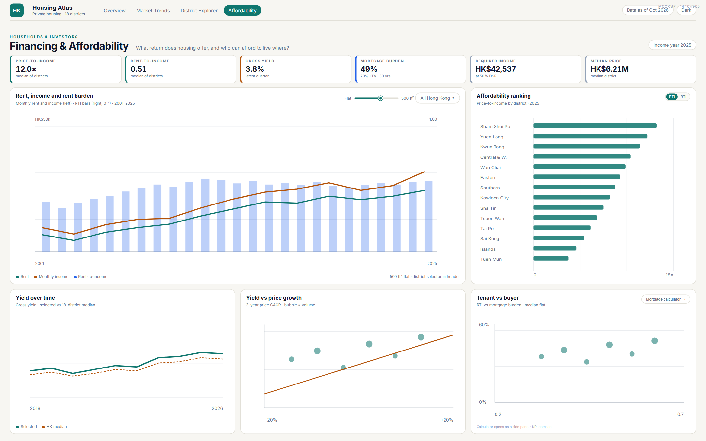

# Desktop one-screen reflow — plan and implementation record

**Project:** HK Housing Atlas
**Target:** fit the primary information of each dashboard on one 1440 × 900 desktop screen
**Status:** implemented in the working tree; not committed
**Date:** 24 October 2026

---

## 1. Objective

The original dashboards were built as long, stacked analytical pages. On a 1440 × 900 screen, Market Trends was about 3,000 px tall, Districts about 2,500 px and Affordability about 2,700 px. The goal of this pass was:

- Keep the existing data, filters and chart behaviour.
- Make the **primary** view of each dashboard visible without vertical scrolling on a typical desktop.
- Show every chart from the mockup at once; use an overlay only for the mortgage calculator.
- Leave mobile and tablet as a normal stacked, scrollable layout.
- Use the mockup set in `docs/design/mockups/` as the visual reference.

The result is verified at **1440 × 900**: Overview, Market Trends, District Explorer and Financing & Affordability all have a document scroll height of exactly **900 px**.

---

## 2. Target viewport and breakpoint

- Primary design canvas: **1440 × 900** CSS px.
- Desktop density is enabled at:

```css
@media (min-width: 1280px) {
  ...
}
```

- The compact layout is selected by **width**, not height, so high-DPI laptops and short browser windows still get the compact KPI/card design.
- At 1440 × 900 all four pages fit exactly. At 1359 × 735 CSS px the very-short desktop rules also fit all four pages.
- Below 1280 px wide, the page falls back to the normal card stack with larger padding and visible descriptions/footer.
- `Methods & data` remains a normal long-form page and is not part of the one-screen target.

### Short desktop viewports

A width-gated rule applies at **≤820 px height**:

- Page and card gaps shrink to 4 px.
- Section padding shrinks to 7 × 10 px.
- KPI cards shrink to 52 px with 14 px values.
- Secondary annotations are hidden with the `short-hide` class:
  - Market: event legend, co-movement R²/slope/n row, and lead/lag summary.
  - Districts: profile headline note, estate-bar caption, and affordability line.
  - Affordability: trend footnote and yield footnote.
- The District map is 220 px tall.

A further rule applies at **≤760 px height** (the 1359 × 735 target):

- Page/card gaps shrink to 1 px.
- Section padding shrinks to 4 × 8 px.
- KPI cards shrink to 44 px with 13 px values.
- The main content has no vertical padding.

This keeps the **charts at their normal height** while removing the spacing that pushed the page past a 735 px viewport.

---

## 3. Desktop density rules

Shared rules live in `app/src/styles.css` under the desktop media query.

### Page shell

- `main` vertical padding reduced from 30 px to 8 px.
- Page-level gaps reduced to 6.4 px at the 1440 × 900 target.
- Page-header bottom margin reduced to 12 px.
- The page question under the H1 is hidden only at heights up to 940 px, so the short desktop view keeps the title and KPI strip tight.
- Footer is hidden on desktop.
- Section-card descriptions are hidden on desktop to keep headers to one line; descriptions remain available on mobile and in the page source.

### Cards

- Section cards use 8 px padding instead of 16–20 px at the 1440 × 900 target.
- Header-to-content gap reduced to 8 px.
- Section titles reduced to roughly 14 px.
- `div.card` padding reduced for non-section cards.

### KPI cards

A dedicated `kpi-card` class was added to the shared `KpiCard`:

| Element | Desktop | Short (≤820 px) | Very short (≤760 px) |
|---|---:|---:|---:|
| Label | 7.5 px uppercase, 0.11 em tracking | 7 px | 7 px |
| Value | 15 px / 1.15 line-height | 14 px | 13 px |
| Note / delta | 7.5 px | 7 px | 7 px |
| Padding | 7 px vertical, 9 px horizontal | 5 px / 8 px | 4 px / 7 px |
| Left accent | 3 px | 3 px | 3 px |
| Card height | 58 px | 52 px | 44 px |
| Grid gap | 7 px | 7 px | 7 px |

This mirrors the `.kpi` rules in the mockup (`height: 58px`, `padding: 7px 9px`, label/value/note 7.5/15/7.5 px) and reduces the KPI strip from roughly 85 px to exactly 58 px. It is shared by Market, Districts and Affordability.

At short desktop heights the strip tightens to 52 px, and at ≤760 px to 44 px, so the charts below still fit.

---

## 4. Page plans

### 4.1 Overview

**Mockup:** `mockups/mock-overview.png`
**Implemented:** `implemented/implemented-overview.png`

Layout:

1. Eyebrow and two-line H1 on the left.
2. Coverage chips on the right:
   `1993–2026`, `18 districts`, `Estate-level history`, `Sale & rent`.
3. One four-column row:
   - Market Trends tile
   - District Explorer tile
   - Financing & Affordability tile
   - **At a glance** panel
4. A one-line footnote: filters, tenure, district and class persist in the URL.

Dashboard tiles contain:

- Kicker, title and question.
- Four bullet points.
- A real screenshot of the corresponding chart, cropped with `object-cover`:
  - Market price/rental indices;
  - District choropleth;
  - Affordability rent/income/RTI chart.
- `Open dashboard →` link.

**At a glance** contains:

- Price index, rent index, gross yield and price-to-income.
- Latest readings from the shared data hooks:
  - price and rent are rebased to 2019 = 100;
  - gross yield is the mean of latest A–E yields;
  - price-to-income is the median of the latest district year.
- Official-index coverage rows.
- Listings count.
- Coverage caveat.
- `Methods & data →` link.

The old standalone “How to read the atlas” and “Coverage” sections were removed; their content is now in the At a glance panel and the footnote.

### 4.2 Market Trends

**Mockup:** `mockups/mock-market-v4.png`
**Implemented:** `implemented/implemented-market.png`

Layout:

1. Page title and class selector.
2. Compact six-card KPI strip.
3. Row 1:
   - **Price and rental indices** — 2/3 width, 240 px chart, event legend below.
   - **Rent–price dynamics** — 1/3 width, 240 px chart, with a `Co-movement | Lead / lag` switch.
4. Row 2 — three equal cards, matching the mockup:
   - **Year-on-year change** — price and rent YoY for the class selected in the top-right Class switch (All/A–E); x-axis starts at 2018. No separate dropdown.
   - **What moves with prices?** — bivariate price/factor scatter, with a factor dropdown (mortgage rate, volume, income, completions).
   - **Composition: what differentiates listings?** — a single PCA biplot with PC1/PC2 labels.

Row 2 is a three-column grid; all three charts are visible at once, as in the mockup.

Chart heights: 240 px for the two top charts, 190 px for the three row-2 charts.

The old version used a tabbed detail card; that hid two of the three charts at a time. The implemented version restores the mockup’s three-card row.

### 4.3 District Explorer

**Mockup:** `mockups/mock-districts-v7.png`
**Implemented:** `implemented/implemented-districts.png`

Layout:

1. Compact seven-card KPI strip.
2. Row 1:
   - **18 districts** choropleth — ~2/3 width; map height 220 px; fit to the full HAD bounds with a maximum zoom of 10.
   - **Hong Kong profile** — ~1/3 width:
     - four profile stats;
     - top six estates by volume as vertical bars: height = transactions, colour = Sale $/ft², hover tooltip;
     - 150 px chart height via `--estate-chart-h`, filling the bottom of the profile card;
     - item-trigger tooltip with series `emphasis` disabled: ECharts 6 was clearing the per-datum bar colour to transparent on hover;
     - affordability line.
3. Row 2:
   - **District × quarter/class heatmap** — vertical colour legend on the right of the cells; all 18 district labels are forced visible with `interval: 0` and a 190 px chart at short heights.
   - **Building age and price** scatter, with Age/MTR switch.
   - **Sale $/ft² by region** — HK Island, Kowloon, New Territories.
4. Coverage card is hidden on desktop; the profile description already states coverage. It remains visible on mobile.
5. District class chips are hidden on desktop to keep the profile within the row height.

Regional price series:

- Computed from `district.panel` rows from 2018 Q1 onward.
- Each region/quarter is a **transaction-volume-weighted average of district sale $/ft²**, not an official RVD regional index.
- Colours: HK Island blue, Kowloon amber, New Territories green.
- Chart height 180 px; latest values are available by hover.

### 4.4 Financing & Affordability

**Mockup:** `mockups/mock-affordability-v2.png`
**Implemented:** `implemented/implemented-affordability.png`

Layout:

1. Compact six-card KPI strip:
   - Price-to-income
   - Rent-to-income
   - Gross yield
   - Mortgage burden
   - Required income
   - Median price
2. Row 1:
   - **Rent, income and rent burden** — 2/3 width.
     - Dual-axis rent/income lines plus RTI bars.
     - Flat-size slider and district selector.
     - 220 px chart.
   - **Affordability ranking** — 1/3 width.
     - Horizontal district bars.
     - PTI/RTI toggle.
     - 220 px chart.
3. Row 2 — three equal cards, matching the mockup:
   - **Yield over time** — selected district against the 18-district median.
   - **Yield vs price growth** — scatter with regression line and volume-sized bubbles.
   - **Tenant vs buyer** — RTI against mortgage burden.
4. **Mortgage calculator** opens as an overlay from the Tenant vs buyer card, preserving the calculator without taking vertical space.
5. The page-level PTI/RTI switch and Rank KPI are gone; both ratios are shown as KPIs.

Chart heights: 220 px for all five visible charts. The calculator is a modal form.

Ranking labels were removed from the 220 px chart because 18 value labels overlapped. District names remain at 8 px with `interval: 0`; exact values are available on hover.

The PTI slope chart from the older layout is no longer in the primary desktop view; the mockup does not include it.

---

## 5. Interaction and state

- Shared filters still come from `useFilters` (property class, selected district, tenure).
- Market:
  - `rentPriceView` switches co-movement and lead/lag.
  - `propertyClass` from the top Class switch filters the hero and the Year-on-year card.
  - `factor` chooses the macro factor.
- Districts:
  - `heatmapMode` switches time/class.
  - `scatterMode` switches age/MTR.
  - `metric` switches sale/rent/yield/price YoY.
  - `estateBarOption` respects the selected district.
- Affordability:
  - `rankingMetric` switches PTI/RTI in the ranking card.
  - `calculatorOpen` controls the mortgage-calculator overlay.
  - `area` remains the flat-size slider.

No tab state is used on the primary desktop view; the mockup charts are all visible at once.

### Card data notes

Every analysis card title is a button with a small `i` marker, and every KPI card is a clickable button. The **Class** label beside the All/A–E switch is also clickable. They open a right-hand data-note drawer containing:

- **What it is** — the metric and its unit/coverage.
- **Source** — publisher and a direct link to the workbook, API, boundary file or crawled website.
- **How it is processed** — the joins, weighting, rebasing, modelling or suppression rules used for that card.

The Composition PCA note additionally renders the **scree** and **loadings** charts inside the drawer. The Class-switch label explains the RVD A–E saleable-area boundaries and the ALL series.

The drawer closes with **Close**, **Escape**, or a click on the backdrop, and links to the full Methods & data page. The metadata lives in `app/src/data/cardInfo.ts`; the drawer and provider are in `app/src/components/DataInfo.tsx`.







The three Overview dashboard tiles remain navigation links rather than data-note targets.

---

## 6. Implementation map

| File | Change |
|---|---|
| `app/src/styles.css` | Desktop density media queries, KPI compact rules, short/very-short layouts, hidden footer/descriptions/coverage |
| `app/src/components/Cards.tsx` | Added `kpi-card`; KPI cards, SectionCard titles and data-note labels open the drawer |
| `app/src/components/DataInfo.tsx` | Right-hand data-note drawer, context and provider |
| `app/src/data/cardInfo.ts` | Per-card source and processing metadata; PCA flag for the extra charts |
| `app/src/components/PcaScreeLoadings.tsx` | Scree/loadings charts rendered inside the PCA data note |
| `app/src/components/Layout.tsx` | Added `app-main` and `app-footer` classes for desktop density |
| `app/src/components/DistrictMap.tsx` | Added configurable `height` prop, default 420; Districts passes 220 |
| `app/src/App.tsx` | Wraps routes in `DataInfoProvider` |
| `app/src/routes/Overview.tsx` | Rebuilt as title/chips + three tiles + At a glance panel; live KPI data hooks; real chart screenshots in tiles |
| `app/public/previews/` | Real chart screenshots for the Overview tiles |
| `app/src/routes/Market.tsx` | Combined dynamics card, class/factor dropdowns, three-card Class/Drivers/PCA row |
| `app/src/routes/Districts.tsx` | Estate bar chart, regional sale-price chart, compact layout |
| `app/src/routes/Affordability.tsx` | PTI/RTI KPI cards, trend + ranking row, three-chart row, calculator overlay |

---

## 7. Verification

At 1440 × 900, with a fresh production build:

| Page | Document scroll height |
|---|---:|
| Overview | 900 |
| Market Trends | 900 |
| District Explorer | 900 |
| Financing & Affordability | 900 |
| Methods & data | 1261 (not in scope) |

At the short desktop size **1359 × 735**:

| Page | Document scroll height |
|---|---:|
| Overview | 735 |
| Market Trends | 735 |
| District Explorer | 735 |
| Financing & Affordability | 735 |

Checks run:

- `npm --prefix app run build` — passes.
- `npm --prefix app test` — 21/21 tests pass.
- `python -m pytest pipeline/tests -q` — 14/14 tests pass.
- Visual captures at 1440 × 900 in `docs/design/implemented/`.
- Short-viewport captures at 1359 × 735 in `docs/design/implemented/short-*.png`.
- Mobile spot checks at iPhone 13 viewport; layout stacks and remains scrollable.

---

## 8. Known constraints and follow-ups

- The one-screen result is verified at **1440 × 900** and **1359 × 735**. Much shorter browser viewports (roughly 640 px, e.g. a 1366 × 768 laptop with browser chrome) will still scroll; there is not enough height to show all primary cards without a different interaction model.
- The desktop compact styles hide section descriptions, the page question, the footer, the District coverage card and the District class chips. All are still present on mobile; descriptions remain in the React source.
- The mortgage calculator is an overlay rather than a permanent card; the PTI slope chart is not in the mockup and is not in the primary desktop view.
- The regional sale-price series is a volume-weighted district aggregate, not an official RVD regional index. This caveat should stay in the card or accompanying documentation.
- `Methods & data` remains a long-form page; the desktop reflow does not apply its one-screen rules.
- No commit or push was made. The working tree contains the implementation and these design files.

---

## 9. Mockup archive

All mockups are static HTML/CSS/SVG, independent of the React app.

- `mockups/mockup.html` — one file containing four sections:
  - `#overview`
  - `#market`
  - `#districts`
  - `#affordability`
- Final renders:
  - `mockups/mock-overview.png`
  - `mockups/mock-market-v4.png`
  - `mockups/mock-districts-v7.png`
  - `mockups/mock-affordability-v2.png`
- Intermediate iterations are preserved alongside the finals as `mock-*-v2.png`, `mock-*-v3.png`, etc.

### Final mockups









### Rendering a mockup

The mockups were rendered with the local Puppeteer skill:

```powershell
node C:\Users\micha\.dsh\skills\browser-screenshot-puppeteer\scripts\shot.js `
  docs\design\mockups\mockup.html `
  docs\design\mockups\mock-overview.png `
  --sel="#overview" --scale=1.5 --wait=".screen"
```

Use `#market`, `#districts` or `#affordability` for the other sections.

---

## 10. Canonical links

- Overview mockup: `mockups/mock-overview.png`
- Market mockup: `mockups/mock-market-v4.png`
- District mockup: `mockups/mock-districts-v7.png`
- Affordability mockup: `mockups/mock-affordability-v2.png`
- Implemented screenshots: `implemented/`
- Shared desktop rules: `app/src/styles.css`
- Shared KPI card: `app/src/components/Cards.tsx`
